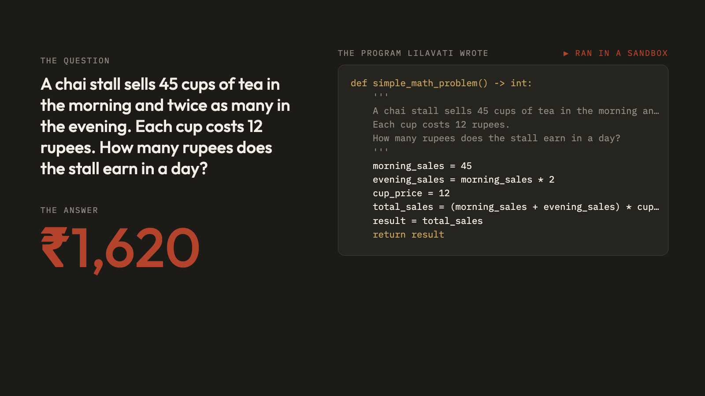
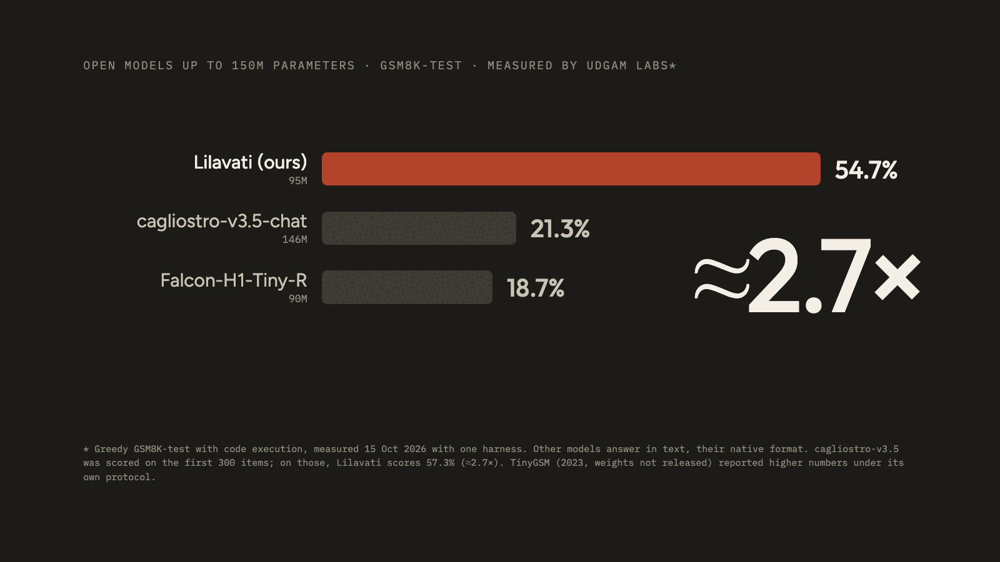

<p align="left"><strong>UDGAM LABS</strong> · Pocket Mathematician</p>

# Lilavati

A 95M-parameter English model that solves **maths word problems by writing a short Python program and running it**.
Trained from scratch by **Udgam Labs**, a frontier technology lab. It runs on a laptop CPU. A second 95M model,
**Lilavati-Checker**, rates its programs, so that many tries can vote.

The name comes from *Līlāvatī* (लीलावती), the book of arithmetic word problems that the mathematician Bhāskara II wrote
in 1150 CE.

**Release, October 2026:** weights and model cards on Hugging Face ([Lilavati](https://huggingface.co/UdgamLabs/Lilavati),
[Lilavati-Checker](https://huggingface.co/UdgamLabs/Lilavati-Checker)), a [try box](https://udgamlabs.com/models/lilavati),
and code, evaluation and checksums in this repository. Apache-2.0.

<p align="center"></p>

[Get started](#get-started) · [How it works](#how-it-works) · [How good is it](#how-good-is-it) · [Limits](#know-the-limits) · [Safety of running code](#running-model-written-code-safely) · [Files](#files)

## Get started

```bash
git clone https://github.com/UdgamLabs/lilavati && cd lilavati
pip install -e .
lilavati "A shop sells pencils at 8 rupees each. Riya buys 6 pencils and 2 erasers at 5 rupees each. She pays with a 100 rupee note. How much change does she get?" --show-program
```

The first run downloads both models (about 190 MB each) from Hugging Face. No login is needed. Python 3.10+,
`torch` 2.3+ and `transformers` 5.18+.

**From Python:**

```python
from lilavati import Lilavati
lv = Lilavati()                       # picks cuda, mps or cpu
r = lv.solve("Meera deposits 25,000 rupees at 8% simple interest per year. How much interest does she earn in 3 years?")
print(r["answer"])                    # 6000
print(r["agreement"], r["confidence"])  # share of tries that agree; checker-weighted support
print(r["program"])                   # the program behind the answer
```

- `solve(q, tries=8)` (default): 8 programs at temperature 0.7, all run, the checker-weighted vote picks the answer.
- `solve(q, tries=1)`: one greedy program, no checker. Fastest.
- When `agreement` or `confidence` is below 0.5, treat the answer as a guess.

**Local playground:** `pip install -e ".[app]"`, run `python app.py`, then open http://127.0.0.1:7860.

## How it works

```
"A chai stall sells 45 cups of tea in the morning and twice as many in the evening. Each cup costs 12 rupees..."
        │
        ▼
 Lilavati (95M) ──► writes N short Python functions (1 greedy, or N samples at temperature 0.7)
        │
        ▼
 structure check + sandboxed run ──► one number per program (or a failure)
        │
        ▼
 Lilavati-Checker (95M) ──► P(correct) for each program
        │
        ▼
 checker-weighted vote ──► answer, agreement, confidence, and the winning program
```

Python does the arithmetic, so the model only has to get the reasoning right. And every answer comes with the program that
produced it, so you can check it.

**Training, in brief:** both models were trained from scratch. Lilavati learned from public synthetic maths datasets with
Python solutions ([TinyGSM](https://huggingface.co/datasets/TinyGSM/TinyGSM),
[tinygsm_mixtral_12M](https://huggingface.co/datasets/reciprocate/tinygsm_mixtral_12M)) and general English text, then
from word problems with execution-verified Python solutions: the GSM8K training split, and problems generated with large
language models and verified by executing their solutions. No test-set problems were used.

## How good is it

All numbers were measured by us. "Code executed" means the program is run and its return value is compared with the
reference answer. Details, commands and the contamination audit: [docs/EVALUATION.md](docs/EVALUATION.md).

| Test set (one greedy try, code executed) | Lilavati |
|---|---|
| GSM8K test (1,319) | **54.7** |
| GSM-Plus testmini, 7 answerable types (2,100) | 39.2 |
| SVAMP (1,000) | 69.9 |
| ASDiv, numeric (2,159) | 74.0 |
| GSM-Hard (1,319) | 43.7 |

With the checker on GSM8K (48 programs per problem): **72.3%** by checker-weighted vote, 66.7% for the checker's single
top pick, and 65.7% by plain majority vote.

<p align="center"></p>

Open models up to 150M parameters, greedy GSM8K test, measured by us on 14 and 15 October 2026 with one harness. Other models
answer in text, their native format. cagliostro-v3.5-chat was scored on the first 300 items; on those, Lilavati scores
57.3% (about 2.7×). TinyGSM (2023, weights not released) reported higher numbers under its own protocol: 68.9% with a
125M verifier picking one of 48 programs, where Lilavati with its checker scores 66.7%. The full table is in
[docs/EVALUATION.md](docs/EVALUATION.md).

## Know the limits

It is good at grade-school word problems: shopping and change, rates and speeds, percentages, discounts and tax, averages,
simple interest, areas and perimeters, and multi-step arithmetic.

It is weak at:
- **irrelevant information:** a number that should be ignored often gets used anyway;
- **working backwards** and problems that **add an extra step** to a familiar pattern;
- **unit conversions** and some **ratio** questions;
- **unanswerable questions:** it always returns a number;
- anything that is not a maths word problem. It is not a chatbot.

Not suitable for grading, financial or medical calculations, or anything where a wrong number could cause harm, without a
person checking the program.

## Running model-written code safely

`lilavati/safe_exec.py` runs every program in three layers:
1. **Structure check before running:** plain arithmetic, variables, functions, loops, conditions, lists and dicts, a short
   list of safe built-ins and `math` only. No other imports, no names starting with `__`, no attribute names starting
   with `_`, no `open`/`exec`/`eval`/`getattr`, no classes, no `with`.
2. **A separate, limited process:** CPU-time, memory, file-size, file-handle and process limits, and a tiny set of
   built-ins. On macOS it also runs under `sandbox-exec` (no network, no file writes).
3. **A wall-clock timeout** of 3 seconds.

This is meant for maths programs from this model. It is not a general-purpose sandbox: for a public service, add your
own isolation (a container or VM).

## Files

| Path | What it is |
|---|---|
| `lilavati/solve.py` | `Lilavati`: writes programs, runs them, asks the checker, votes |
| `lilavati/safe_exec.py` | the structure check and the limited runner |
| `lilavati/__main__.py` | the `lilavati` command |
| `app.py` | the local Gradio playground (also the Hugging Face Space) |
| `eval/gsm8k.py` | the GSM8K scorer used for the numbers above |
| `examples/` | small runnable examples |
| `docs/EVALUATION.md` | every number, how it was measured, the comparison and the contamination audit |
| `SHA256SUMS` | checksums of the released weight files |

## Licence

Code and weights: Apache-2.0.

## Citation

```bibtex
@misc{lilavati2026,
  title  = {Lilavati: a 95M pocket mathematician that solves word problems by writing Python},
  author = {Udgam Labs},
  year   = {2026},
  url    = {https://huggingface.co/UdgamLabs/Lilavati}
}
```
